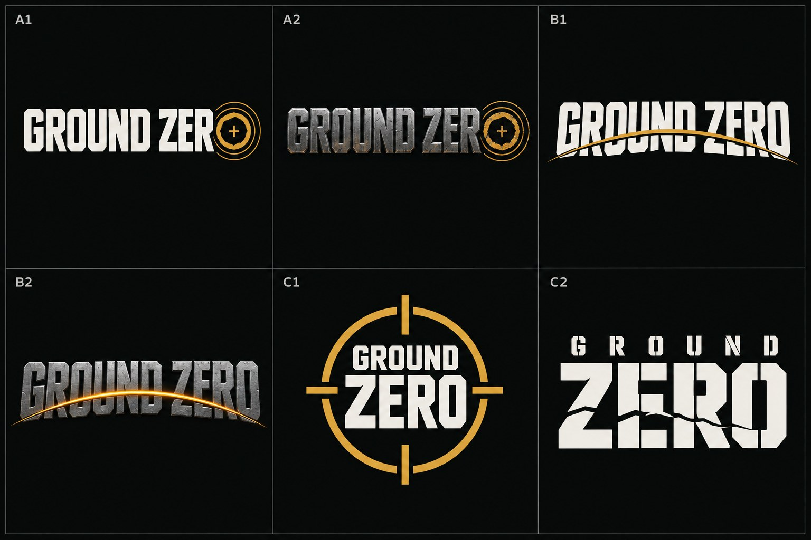
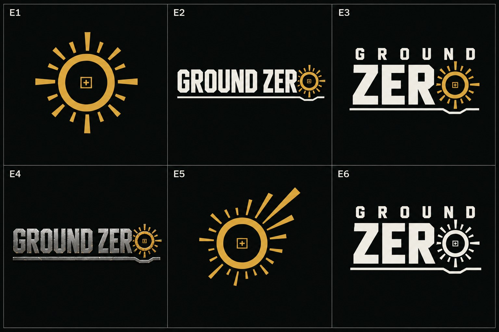
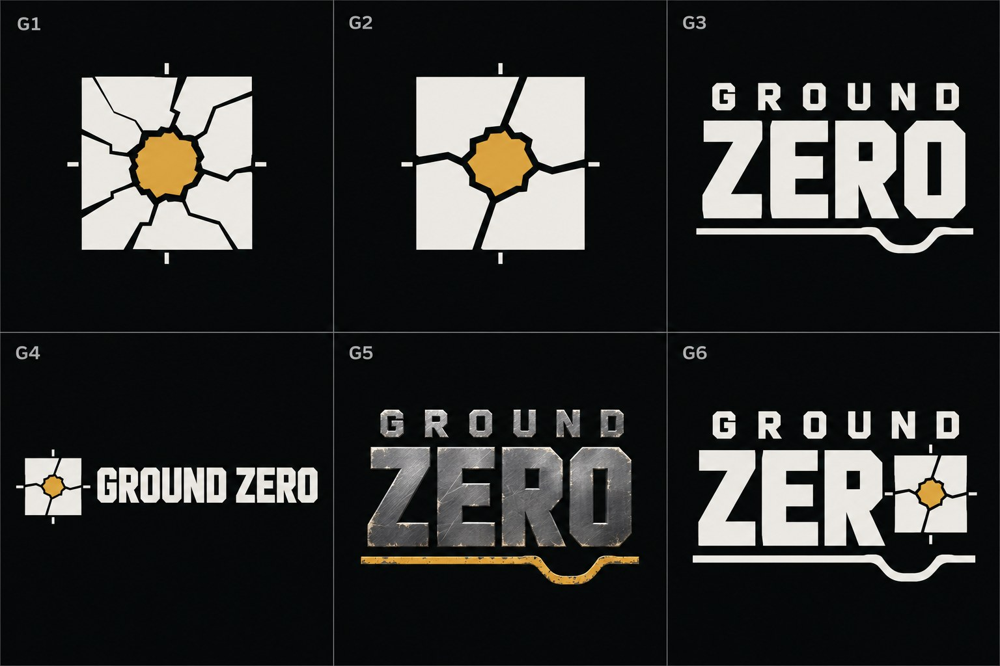

# O logo do jogo (Ground Zero, por enquanto)

**Estado (07/11): ESCOLHIDO o G3 da folha 3** (ele: "eu fico com G3").
- O desenho: a versão chapada, GROUND espaçado sobre ZERO grande, em duas cores. A linha do chão embaixo afunda numa cratera (o perfil,
  como num corte geológico) bem debaixo do O.
- A imagem: `docs/aprovados/telas/2026-11-07_logo_G3_ESCOLHIDO.jpg` (o recorte 512 × 512 da folha 3).
- A G5 (a mesma forma em aço escovado, com a linha em âmbar gasto) era a outra candidata. Não foi escolhida.
- Ainda é a imagem gerada. O letreiro de verdade (vetor, letra própria) se desenha em cima dela quando for pra caixa, o menu ou o .exe.

Ele tinha pedido: "procurar um logo foda no Atelier, mas que seja bem feito, bem pensado, icônico pra caralho, icônico nível C&C ZH,
bonito, original". O nome e o porquê dele estão em `docs/VISAO_DO_JOGO.md` ("O nome").

**O ícone do .exe (06/11): o tanque dele.** O tanque de chapas enferrujadas que ele mesmo fez (`Atelier/app/icon/game_icon.webp`,
o mesmo de onde sai o ícone dourado do Atelier). Ele: "eu gosto dele [...] não é pra usar no menu [...] dá até pra colocar no .exe do
jogo". Feito por `Game/Tools/make_exe_icon.py` → `Game/Build/Windows/Application.ico` (16 a 256 px, fundo transparente, nitidez leve
até 48 px). O logo continua sendo outra coisa: o letreiro abaixo.

## O estudo curto (antes de gerar)

O que faz um logo de RTS ficar na cabeça:
1. **Um sinal só, que se lê pequeno:** a marca funciona do ícone do app à caixa. A forma do letreiro e a placa metálica do ZH se
   reconhecem até em miniatura.
2. **A ideia do jogo dentro da marca:** aqui, o marco zero: o ponto no chão debaixo da explosão, que muda o mapa pra sempre.
3. **Letra militar pesada e condensada, com um corte próprio:** não uma fonte de prateleira.
4. **Duas versões:**
   - a chapada (duas cores), pro menu e o HUD;
   - a "de capa" (aço gasto), como os logos de RTS dos anos 2000.
5. **Fugir do clichê:** nada de cogumelo nuclear, caveira, fogo, globo, símbolo da radiação, nem nada que lembre o 11 de setembro.

Referência comercial só se estuda por escrito: nenhum logo existente vai anexado ao gerador (regra de 04/11).

## Folha 1 (06/11): três direções, chapada e "de capa"

- **Como foi gerada:** GPT pelo Atelier, 1 imagem, 3:2, sem anexos. O pedido e a pasta são `captures/concept/258_logo_ground_zero_folha_1/`
  (`atelier.json` tem o prompt inteiro), id `mw5ddl1si49`.
- **As cores:** aço gunmetal, osso `#ECEBE6` e o âmbar das telas `#D8AD4E`, no fundo das telas `#0A0D0B`.
- **A leitura minha, com rigor:**
  - **A (EPICENTRO, o "O" visto de cima, a cratera com os anéis):** é a única com um sinal próprio ligado à ideia do jogo. A
    execução está fraca: o anel parece uma moeda ou uma mira solta, e as letras são genéricas.
  - **B (ONDA DE CHOQUE):** o arco virou um "swoosh" de logo esportivo.
  - **C1 (RETÍCULA):** é a mira de jogo de tiro, clichê.
  - **C2 (ESTÊNCIL RACHADO):** é limpo, mas genérico.
  - Nenhuma está no nível pedido ainda. O próximo passo, se ele concordar, é aprofundar a A: a cratera como símbolo forte e a
    letra com corte próprio.

## O prompt da folha 1 (inteiro, em `captures/concept/258_logo_ground_zero_folha_1/atelier.json`)

Em resumo: uma folha 3 × 2 de seis logos "GROUND ZERO" num fundo `#0A0D0B`, com os rótulos A1–C2.
- **A, EPICENTER:** o O de ZERO é o epicentro visto de cima: o anel da cratera, dois anéis finos da onda e uma cruzinha de marco
  topográfico no centro.
- **B, SHOCKWAVE:** um arco de onda de choque corta as letras e as desloca, com a fratura embaixo.
- **C1, MARKER:** um emblema quadrado de retícula.
- **C2:** um estêncil com GROUND pequeno sobre ZERO grande e o Z rachado.
- Cada direção chapada (2 cores) e "de capa" (aço chanfrado gasto com o âmbar).
- Proibido: cogumelo, fogo, caveira, globo, trevo da radiação, prédios, bandeiras e palavras extras.

## Folha 2 (06/11): aprofundando a A, "o epicentro" (ele: "aprofunda no A como você falou")

- Pedido `mw5dvh0e0mm`, pasta `captures/concept/259_logo_ground_zero_folha_2_o_epicentro/` (o prompt inteiro no `atelier.json`).
- **O que foi pedido:** a cratera vista de cima, com o aro, os raios curtos de material ejetado e o marco topográfico no centro, e a
  letra com cantos chanfrados.
- **Reprovada por mim:** os raios em volta do aro viraram um **sol**, exatamente o que o prompt proibia. O que presta é a estrutura
  do E3: GROUND espaçado sobre ZERO grande, com a linha do chão que quebra.
- Lição: cratera com raios em volta, em desenho chapado, vira sol. O chão tem de aparecer partido, nunca irradiando.

## Folha 3 (06/11): "o chão partido"

- Pedido `mw5dxzb0ujx`, pasta `captures/concept/260_logo_ground_zero_folha_3_o_chao_partido/` (o prompt inteiro no `atelier.json`).
- **O pedido:** o chão partido de dois jeitos.
  - **De cima:** um quadrado do quadriculado do mapa militar com a cratera furada no meio e as rachaduras retas até as bordas,
    em placas deslocadas.
  - **De lado:** a linha grossa do chão debaixo da palavra, que afunda numa cratera precisa (a bacia com a borda levantada) bem
    embaixo do O.
- **A melhor até agora: G3 (chapado) e G5 (de capa, aço escovado com a linha em âmbar gasto).**
  - A cratera em perfil na linha do chão é um sinal próprio, original e ligado ao nome. Ela se lê pequena e funciona em uma cor só.
- **G1/G2 (o quadrado partido):** é um bom caminho pro ícone do app. O miolo âmbar ainda parece uma gema de ovo; tem de virar uma
  cratera de verdade.
- **G4 e G6:** juntam coisa demais.
